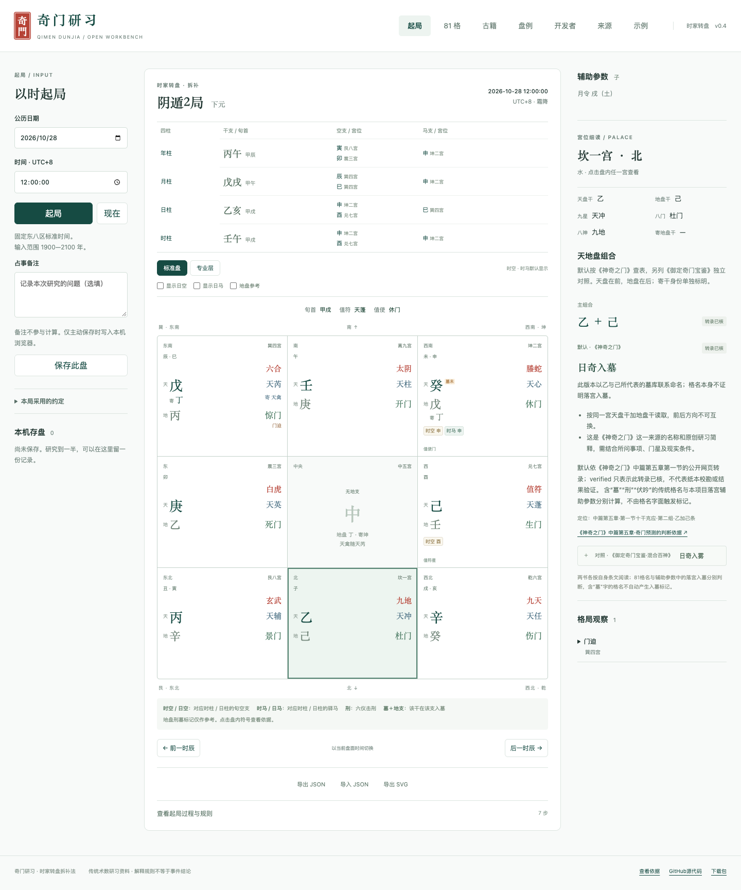

# Qimen Study Workbench

[Repository](https://github.com/agixufeng/qimen-ai) · [Live demo](https://agixufeng.github.io/qimen-ai/) · [Downloads](https://github.com/agixufeng/qimen-ai/releases)

[简体中文](README.md)

The repository is named `qimen-ai`; AI interpretation is not implemented in this release.

A TypeScript Qimen Dunjia turning-board engine and a local-first React/Vite demo. Version 0.4.0 is a candidate for external rule review, not an independently certified calculation standard.

Fixed UTC+8 standard time, Gregorian years 1900–2100, chaibu method, day stem changes at 23:00, center hosted by Kun (2), Tianqin travels with Tianrui. The original civil timestamp remains unchanged for solar-term comparisons. No accounts, API keys, database, remote fonts or telemetry.

[](https://agixufeng.github.io/qimen-ai/#/chart)

Local browser acceptance capture using the public synthetic input `2026-10-28 12:00:00 UTC+8`. Click the image to open the live workbench. [Asset provenance](docs/assets/README.md).

## Try the workbench

The study UI is currently in Chinese. Open the [live chart](https://agixufeng.github.io/qimen-ai/#/chart) with the public synthetic input `2026-10-28 12:00:00` UTC+8. Click `时空 申` in Kun palace (2) to inspect the hour pillar, xun, affected branch and rule source. On mobile, details appear below the chart.

The [study corpus](https://agixufeng.github.io/qimen-ai/#/cases) separates generated charts from classical hypothetical examples. Filter `程序盘例`, open `查看详情`, then `在工作台打开` to replay a generated record. Classical records without a complete date retain their supplied conditions.

The Chinese-language [project overview](https://agixufeng.github.io/qimen-ai/about.html) and [rule guide](https://agixufeng.github.io/qimen-ai/rules.html) also work without JavaScript.

## Run

Use Node.js 22 LTS and npm 10+.

```sh
git clone https://github.com/agixufeng/qimen-ai.git
cd qimen-ai
npm ci
npm run dev
npm run typecheck
npm test
npm run build
npx playwright install chromium
npm run test:browser
```

The production site is `apps/web/dist`, uses relative assets and hash routes, and can be hosted under a GitHub Pages subpath. Build the core before importing `packages/core/dist/index.js`.

## API and evidence

`generateQimen(input, profile?)` returns a versioned structured chart; `detectPatterns(chart)` returns explicit matches. `analyzeChart(chart, annotationProfile?)` adds four-pillar voids and horses, palace branches, punishments, tombs, twelve growth stages, seasonal strengths, door-palace relations and inner/outer regions. The base chart engine/profile stays unchanged for reproducibility. Standard/professional views and independent daily/earth toggles affect display only. `exportChart` creates version-2 documents with complete annotations and display options; `importChart` compares base and annotation results separately and reads version-1 documents without overwriting them. SVG exports contain chart facts, never private notes. Browser history is stored only on explicit save.

The 81 ordered stem pairs default to *Shenqi Zhi Men*, with independently authored summaries and a separate *Yuding Qimen Baojian / Hunhe Baishen* comparison for every pair. Names, conditions, locators and review states are kept separate; searches cover both books. The knowledge profile is `shenqi-first-dual-v1`. Suspected transcription characters remain pending per source, including the Yuding Xin+Xin entry. This is not facsimile collation or evidence of divination accuracy.

36 complete fixtures are AI-assisted independent rule derivations with literal expected outputs and worked steps. They were produced independently of the production engine, but are not externally reviewed gold-standard charts. The two implementations may share rule misunderstandings. Solar-term timestamps depend on lunar-javascript 1.7.7, not an independent astronomical ephemeris.

Code: MIT. Original documentation, knowledge summaries and fixtures: CC BY 4.0. Third-party references retain their rights; no modern books or course transcripts are distributed. See the Chinese README and docs for the full rule profile, references and publication checklist. Deployment results are recorded in the repository's GitHub Actions runs.

## Release candidate and CLI

To use the CLI without building the website, install all four packages from the public GitHub Release inside your Node.js project:

```sh
npm install --ignore-scripts \
  https://github.com/agixufeng/qimen-ai/releases/download/v0.4.0/qimen-core-0.4.0.tgz \
  https://github.com/agixufeng/qimen-ai/releases/download/v0.4.0/qimen-knowledge-0.4.0.tgz \
  https://github.com/agixufeng/qimen-ai/releases/download/v0.4.0/qimen-cases-0.4.0.tgz \
  https://github.com/agixufeng/qimen-ai/releases/download/v0.4.0/qimen-cli-0.4.0.tgz
npx --no-install qimen chart --datetime 2026-10-28T12:00:00
```

Installation needs network access for these tarballs and the pinned calendar dependency. Subsequent CLI calculation is offline. These are GitHub-hosted tarballs, not npm-registry publications. Inventory and SHA-256 files are attached to the same [release](https://github.com/agixufeng/qimen-ai/releases/tag/v0.4.0).

After building, run `node packages/cli/dist/bin.js chart --datetime 2026-10-28T12:00:00`. JSON is replayable; `--professional --format svg` exports annotations. No clock or network is read during calculation. UTC+8 timestamps must omit offsets.

`npm run release:prepare` assembles source, web and four npm tarballs and a separate study dataset with manifests and SHA-256 under ignored `.local/releases/v0.4.0`. `npm run release:smoke` installs the packages into an isolated directory with npm access during installation and verifies JSON/SVG and replay. This is not an npm registry publication.

The website adds a developer entry and three classical-book catalogues with six verified section locators and original study notes, not full transcriptions. The study corpus now contains exactly 10,000 records: 9,998 generated charts, two classical hypothetical examples and zero reported real-world cases. Types and missing feedback remain explicit in the website and downloads. Synthetic charts are reproducible outputs, not independent correctness standards.
