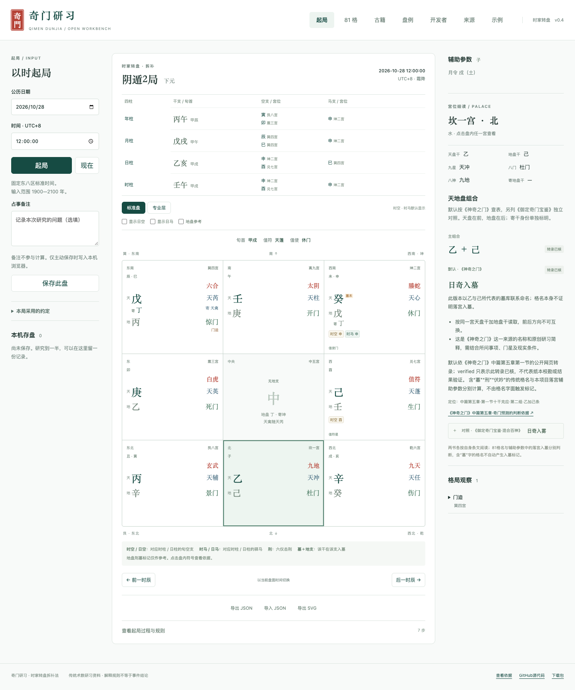

# 奇门 · 研习

[GitHub](https://github.com/agixufeng/qimen-ai) · [在线演示](https://agixufeng.github.io/qimen-ai/) · [下载包](https://github.com/agixufeng/qimen-ai/releases)

[English](README.en.md)

仓库名为 `qimen-ai`；本版提供确定性排盘与研习能力，AI解读尚未实现。

时家转盘拆补法的 TypeScript 排盘核心、规则出处与本地研习工作台。v0.4.0 是待外部校核的开源候选版，适合检查与学习盘法。

**范围：固定 UTC+8、公历1900—2100、子初23点换干支日、中五寄坤、天禽随芮。** 核心在浏览器本地计算，无账号、API Key、数据库、遥测或外部字体请求。页面首次展示公开演示时间，点击“现在”才读取当前时间。

[](https://agixufeng.github.io/qimen-ai/#/chart)

公开合成时间 `2026-10-28 12:00:00 UTC+8` 的本机验收截图；点击图片可打开工作台。截图说明见[素材记录](docs/assets/README.md)。

## 直接试用

1. [打开工作台](https://agixufeng.github.io/qimen-ai/#/chart)，以公开合成时间 `2026-10-28 12:00:00`（UTC+8）起局。
2. 点击坤二宫的“时空 申”，查看时柱、旬首、具体空支、条件和规则来源。手机在盘面下方查看详情。
3. [打开盘例](https://agixufeng.github.io/qimen-ai/#/cases)，筛选“程序盘例”，点击“查看详情”后在工作台打开。古籍教学例保留原条件，缺日期时不重排。

查看双书异名时，可到[81格](https://agixufeng.github.io/qimen-ai/#/combinations)搜索“乙丁”。默认条目与御定对照分别保留出处。

## 快速开始

Node.js 22 LTS，npm 10 或更新版本：

```sh
git clone https://github.com/agixufeng/qimen-ai.git
cd qimen-ai
npm ci
npm run dev
```

打开终端显示的本机地址。无环境变量、无后端。国内历史钟表时间若涉及夏令时，须先自行明确换算为UTC+8标准时间；界面不猜测出生地、时区或太阳时。

```sh
npm run typecheck
npm test
npm run build
npx playwright install chromium
npm run test:browser
```

本机已有Chrome时可使用 `QIMEN_BROWSER_CHANNEL=chrome npm run test:browser`，测试采用独立临时profile。

在Linux CI中使用 `npx playwright install --with-deps chromium`。静态产物在 `apps/web/dist/`；Vite使用相对base，页面用hash导航，支持GitHub Pages子路径。运行 `npm run preview -w @qimen/web -- --port 4186` 检查生产构建。

## 命令行与下载包

只调用排盘时，可在已有Node工程中直接安装[v0.4.0 Release](https://github.com/agixufeng/qimen-ai/releases/tag/v0.4.0)的四个包，无需先构建网站：

```sh
npm install --ignore-scripts \
  https://github.com/agixufeng/qimen-ai/releases/download/v0.4.0/qimen-core-0.4.0.tgz \
  https://github.com/agixufeng/qimen-ai/releases/download/v0.4.0/qimen-knowledge-0.4.0.tgz \
  https://github.com/agixufeng/qimen-ai/releases/download/v0.4.0/qimen-cases-0.4.0.tgz \
  https://github.com/agixufeng/qimen-ai/releases/download/v0.4.0/qimen-cli-0.4.0.tgz
npx --no-install qimen chart --datetime 2026-10-28T12:00:00
```

首次安装需要联网下载这些包及固定历法依赖，安装后的CLI计算可离线。文件清单与SHA-256在同一Release；手动下载四个tgz时也可按[版本说明](docs/release-notes.md)从本地安装。

源码构建后可直接离线计算（首次npm安装依赖需要网络）：

```sh
node packages/cli/dist/bin.js chart --datetime 2026-10-28T12:00:00
node packages/cli/dist/bin.js chart --datetime 2026-10-28T12:00:00 --professional --day-horse --format svg > qimen.svg
```

时间固定UTC+8，不附Z或偏移。默认输出可重放JSON，错误写stderr并退出2。包尚未发布到npm registry；上面的地址明确从GitHub Release安装，见[版本说明](docs/release-notes.md)。

```sh
npm run release:prepare
npm run release:smoke
npm run release:source-smoke
```

产物位于忽略目录`.local/releases/v0.4.0`：源码包、静态站包、四个npm tarball及独立研习库包、文件清单、MANIFEST与SHA-256。验证采用隔离目录实际安装（安装阶段可访问npm）；已有输出目录不会被覆盖，重建时传入一个新的`.local/`目录。打包命令需Git工作区；源码烟测会解压后在隔离目录执行npm ci、类型检查、单元测试及生产构建。此命令只在本机打包，不创建仓库、推送或部署。

## 核心用法

先 `npm run build`。workspace或Node直接导入构建后的ES模块：

```js
import { generateQimen, analyzeChart, detectPatterns, exportChart } from './packages/core/dist/index.js';
const chart = generateQimen({ year:2026, month:10, day:28, hour:12, minute:0, second:0 });
console.log(chart.dun, chart.ju, chart.chiefStar, detectPatterns(chart));
console.log(analyzeChart(chart));
console.log(exportChart(chart));
```

`generateQimen(input, profile?)` / `detectPatterns(chart)` 都是确定性计算。`nowUtc8()`是界面便利函数，显式读取时钟，不参与核心算法。完整接口见 [API说明](docs/api.md)。

## 工作台功能

起局与前后时辰、标准洛书九宫、原位与寄宫分别显示、宫位详情、格局条件与来源、81组合搜索、来源登记、示例盘、本机主动保存和单条删除、JSON重算导入与SVG导出。SVG不含占事备注；JSON可含备注，导出前请自行审阅。

v0.2补齐四柱旬空与驿马、宫支、六仪击刑、入墓、十二长生、星门宫旺衰、门宫关系与内外盘。标准盘突出时空、时马、刑墓和门迫；专业层展开长生与旺衰，日空、日马、地盘参考可独立开关。点击符号查看计算依据、规则版本和来源。开关只改变显示。

JSON新版保存基础盘、完整辅助结果和显示选项；导入分别报告两层一致性，兼容v0.1记录但不覆盖原存盘。SVG同步导出所选辅助层与图例，始终不含备注。

新增“古籍”与“开发者”入口。三部古籍提供6个已核章段的索引和原创导读，不是完整全文库；历史定局取法与当前规则的区别逐书注明。

目前检测星伏吟、星反吟、门伏吟、门反吟与门迫。81组合是天盘干＋地盘干，顺序不可交换，默认采用《神奇之门》十干克应的格名与原创简释，并逐条保留《御定奇门宝鉴·混合百神》对照；两书名称、简释和复核状态独立标注，名称搜索覆盖两书。知识配置版本为`shenqi-first-dual-v1`。御定辛辛及神奇网页疑字保留各自待核状态。状态“已核”仅代表来源转录核对，不代表影印本校勘或预测有效性。

## 一万条混合研习库

本版提供 **10000条记录：9998程序盘例＋2古籍教学例＋0来源自述占验**。页面按类型独立计数，可筛选、分页和按需查看；记录及全量JSONL.gz下载均保留来源和证据标签。不能把合成盘或古籍假如例称为真实占验。

```sh
npm run build
npm run data:check
```

构建从固定2024—2026候选网格、36参考输入和2026精确边界生成，不读当前时钟；输出到忽略目录`apps/web/public/cases/`。所有10000条、100个分块和解压JSONL做一致性检查；9998条生成盘全部按保存规则重放。覆盖18局、6旬、81组合、空马刑墓、24交节前中后及23点边界，只说明当前引擎输出覆盖，不是新增一万个独立正确答案。

古籍两条来自《遁甲演义》天遁假如例，没有可核公历日期、完整九宫与实际反馈，只展示原条件，禁止补日期重排。详见[数据说明](docs/study-data.md)。

## 规则与验证边界

- [v0.2辅助规则](docs/annotations.md)及[从真参考边界](docs/congzhen-reference.md)：规则版本独立，不声称复现从真内部算法。
- [完整规则](docs/rules.md)：节气、符头、三元、旬首、寄宫、星门神和格局判据。
- [来源](docs/sources.md)与[术语分歧](docs/terminology.md)：不把天乙、终身日干等异说压成通用结论。
- [36个对照盘](fixtures/README.md)：由独立规则推演脚本构造并保存固定期望值，未调用生产引擎；属于AI辅助推演资料，**尚非第三方或人工审定金标准**。两份实现可能共有对同一规则的误解。
- 历法依赖 lunar-javascript 1.7.7。交节边界测试确认程序使用库给出的时刻，不构成对天文历表误差的独立验证。

这是一套传统术数规则的实现。可复现、测试通过与预测效力是不同问题。首版不含AI解读、终身行运、飞盘、置闰、真太阳时或历史夏令时自动校正。

## 项目结构与贡献

`packages/core`计算；`packages/knowledge`知识；`apps/web`界面；`fixtures`参考与推演；`tests`回归；`docs`规则与开发资料。改盘面结果须同时提交来源、盘例与回归测试，见 [CONTRIBUTING](CONTRIBUTING.md)。

代码MIT；原创说明与样例CC BY 4.0。古籍书目与现代参考链接不意味着获得第三方全文的再分发许可。见 LICENSE、DATA-LICENSE、[来源登记](docs/sources.md)。

架构学习参考 [Renhuai123/ziwei-doushu](https://github.com/Renhuai123/ziwei-doushu/tree/ff9a1470ebe652e57b9d690f5d01db9a04f47aae) 和 [Metis紫微](https://metisziwei.com/)。本项目独立编写，无复制其商业断语、插画或接口。历法基础依赖 [lunar-javascript](https://github.com/6tail/lunar-javascript)。

历史基线为124项单元测试及14组浏览器流程；v0.3新增CLI、发布包与古籍验收结果见 [验收记录](docs/verification.md)。

公开目标为 `agixufeng/qimen-ai`。[手动Pages部署配置](docs/deployment.md)不会随push自动部署；启用PagesSource后手动触发。部署执行结果以[Actions](https://github.com/agixufeng/qimen-ai/actions)为准，文件范围与步骤见[发布清单](docs/release-checklist.md)。
